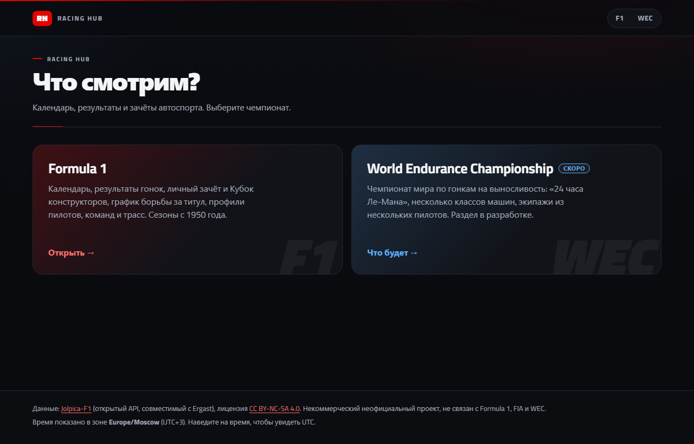
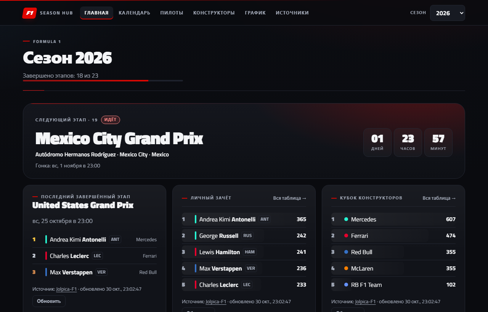
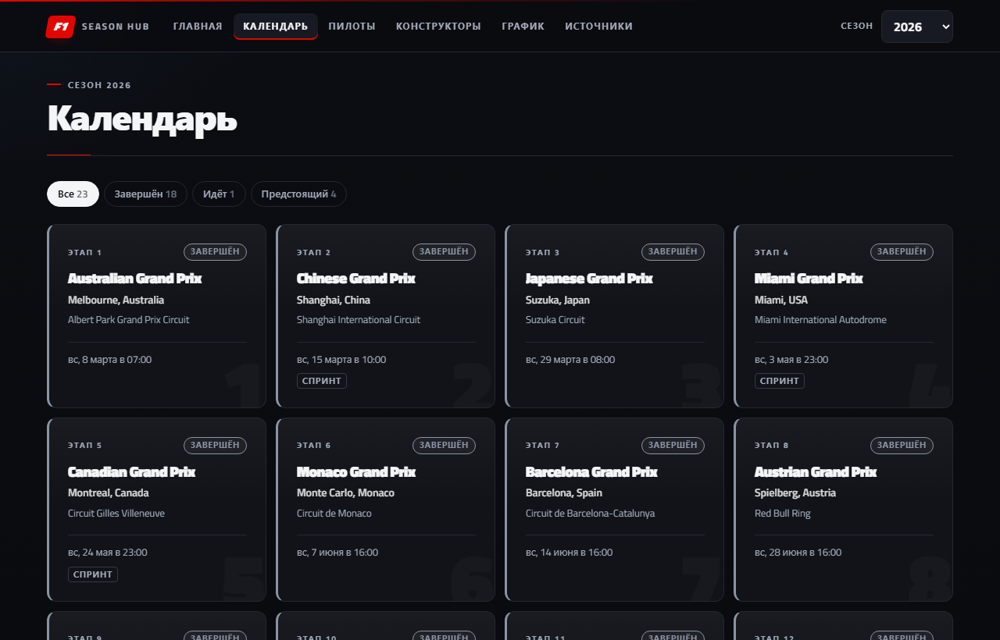
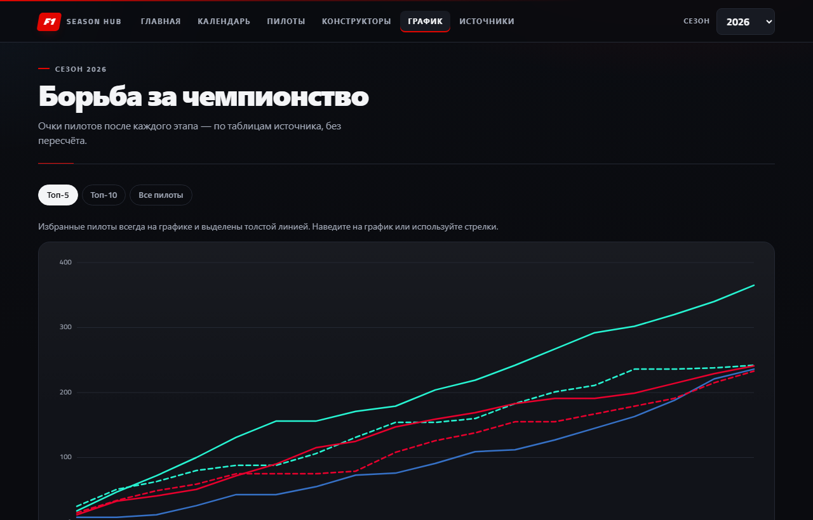
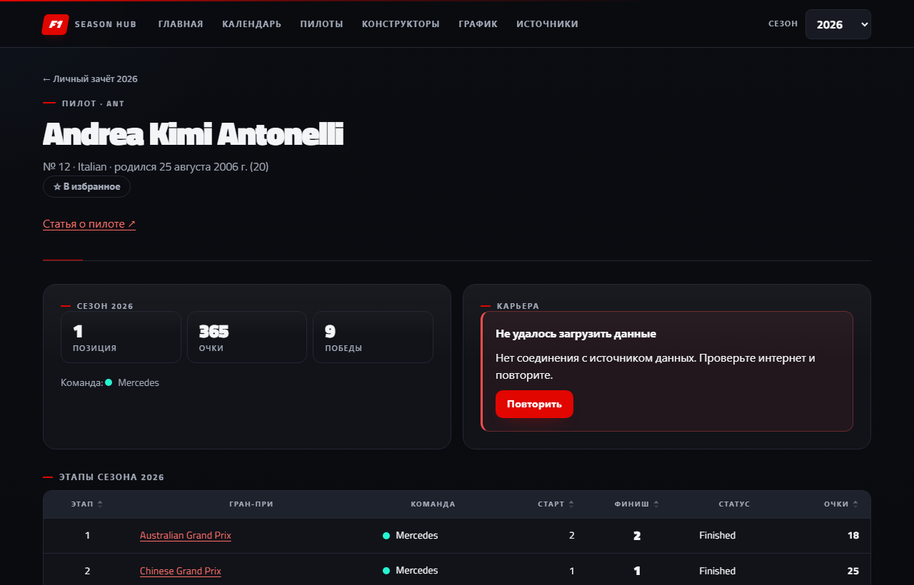

# 🏁 Racing Hub

[](https://github.com/Ait102/racinghub/actions/workflows/ci.yml)
[](https://github.com/Ait102/racinghub/actions/workflows/api-health.yml)


**Racing Hub** — календарь, результаты и зачёты автоспорта в одном месте. На старте сайт спрашивает, что смотреть:

- **Formula 1** — готово: от первого Гран-при 1950 года до текущего сезона;
- **WEC** — чемпионат мира по гонкам на выносливость, раздел в разработке.

**🌐 Сайт: https://ait102.github.io/racinghub/**

> [!NOTE]
> **Проект в разработке.** Раздел Formula 1 готов: все этапы SDLC по ТЗ v0.2 пройдены, backlog P0–P2 выполнен.
> Дальше — **WEC** и новые идеи. Подробнее — в разделе [«Дальше: WEC»](#-дальше-wec).



## ✨ Возможности

|                           |                                                                                |
| ------------------------- | ------------------------------------------------------------------------------ |
| 🗓 **Календарь**           | все этапы сезона, статусы «Завершён / Идёт / Предстоящий», выделен ближайший   |
| 🏆 **Результаты**         | гонка, квалификация и спринт; поиск и сортировка                               |
| 📊 **Зачёты**             | личный и Кубок конструкторов — ровно как у источника, без пересчёта            |
| 📈 **График чемпионства** | очки пилотов после каждого этапа, подсказка и управление с клавиатуры          |
| 👤 **Профили**            | пилоты, команды и трассы: биография, сезон по этапам, статистика карьеры       |
| 🗺 **Схемы трасс**         | контур конфигурации именно того года, длина, повороты, направление             |
| ⭐ **Избранное**          | отметьте пилотов и команды — они подсвечиваются в таблицах и на графике        |
| 📱 **Везде**              | телефон и компьютер, тёмная тема, навигация с клавиатуры                       |
| 🛡 **Надёжность**          | кэш, лимит запросов, понятные ошибки; если API недоступен — сохранённые данные |

<table>
  <tr>
    <td></td>
    <td></td>
  </tr>
  <tr>
    <td align="center">Главная F1</td>
    <td align="center">Календарь</td>
  </tr>
  <tr>
    <td></td>
    <td></td>
  </tr>
  <tr>
    <td align="center">График чемпионства</td>
    <td align="center">Профиль пилота</td>
  </tr>
</table>

## 🚀 Запуск

```bash
npm install
npm run dev
```

Откройте **http://localhost:5173**. Бэкенд и ключи не нужны: данные берутся из открытого API.

### Команды

| Команда                 | Что делает                                                                |
| ----------------------- | ------------------------------------------------------------------------- |
| `npm run dev`           | сайт для разработки с автообновлением                                     |
| `npm run build`         | production-сборка в `dist/` (статика, работает из любой папки)            |
| `npm test`              | unit- и компонентные тесты (Vitest)                                       |
| `npm run test:e2e`      | сквозные тесты в браузере (первый раз: `npx playwright install chromium`) |
| `npm run test:contract` | проверка живого API: доступен ли и не поменялся ли формат                 |
| `npm run test:visual`   | сравнение скриншотов страниц с эталонами                                  |
| `npm run lint`          | ESLint                                                                    |
| `npm run format`        | Prettier: единый стиль и порядок импортов                                 |

## 🧱 Стек

**React 18** · **TypeScript** · **Vite 8** · **React Router 7** · **Vitest** · **Playwright** · **ESLint** · **Prettier**

Без UI-библиотек: стили — обычный CSS, график — свой SVG.

## 🗂 Структура

Один сайт, разделы по чемпионатам. Общая часть — в корне `src/`, всё про конкретный чемпионат — в `src/series/<чемпионат>/`.

```
src/
├─ api/              общий HTTP-клиент: тайм-аут, 429, кэш, запасные данные
├─ components/       общие: таблица, состояния загрузки и ошибок, шапка, мелкие UI-элементы
├─ hooks/            общие: загрузка данных по ключу, текущее время
├─ lib/              даты, часовой пояс, очки
├─ styles/           стили по областям, точка входа index.css
└─ series/
   ├─ f1/            Formula 1 — готовый раздел
   │  ├─ api/        эндпоинты Jolpica
   │  ├─ domain/     модель, разбор JSON, статусы этапов, поиск, данные графика
   │  ├─ hooks/      загрузка по сезону, избранное
   │  ├─ components/ ячейки пилота и команды, график, схема трассы
   │  ├─ data/       контуры трасс (F1DB)
   │  ├─ pages/      страницы
   │  └─ contract/   проверки живого API
   └─ wec/           WEC — заготовка, см. src/series/wec/README.md
```

Общий код и WEC не могут импортировать что-то из `series/f1` — это проверяет ESLint.

<details>
<summary><b>Все страницы</b></summary>

| Адрес                         | Что показывает                                                           |
| ----------------------------- | ------------------------------------------------------------------------ |
| `#/`                          | выбор чемпионата: F1 или WEC                                             |
| `#/f1`                        | вход в F1: открывает последний (или последний просмотренный) сезон       |
| `#/wec`                       | раздел WEC — пока описание того, что будет                               |
| `#/{season}`                  | главная: следующий этап, подиум последнего, лидеры зачётов               |
| `#/{season}/calendar`         | календарь с фильтром по статусу                                          |
| `#/{season}/race/{round}`     | схема трассы, расписание сессий, результаты гонки, квалификации, спринта |
| `#/{season}/drivers`          | личный зачёт                                                             |
| `#/{season}/constructors`     | Кубок конструкторов                                                      |
| `#/{season}/chart`            | график борьбы за чемпионство                                             |
| `#/{season}/driver/{id}`      | профиль пилота                                                           |
| `#/{season}/constructor/{id}` | профиль команды                                                          |
| `#/{season}/circuit/{id}`     | профиль трассы и победители по годам                                     |
| `#/about`                     | источники данных, правила статусов, часовой пояс                         |

</details>

## 🔎 Как приложение обращается с данными

- Очки и позиции берутся из таблиц источника — приложение **ничего не пересчитывает**.
- Нет данных — показывается «—», значения **не придумываются**.
- Под каждым блоком — источник, время загрузки и кнопка «Обновить».
- Если API недоступен, показываются последние сохранённые данные с предупреждением.

## 🌐 Публикация

Сайт бесплатно хостится на **GitHub Pages**. Каждый пуш в `main` прогоняет линтер и тесты, собирает сайт и публикует его — только если всё прошло (`.github/workflows/ci.yml`).

## ✅ Качество

| Проверка                   | Результат     |
| -------------------------- | ------------- |
| Unit- и компонентные тесты | 73 / 73       |
| Сквозные тесты в браузере  | 20 / 20       |
| Проверка живого API        | 6 / 6         |
| Сверка с formula1.com      | 0 расхождений |
| Уязвимости зависимостей    | 0             |
| ESLint / Prettier          | 0 замечаний   |

Подробности — в [отчёте о тестировании](docs/TESTING.md). Как поддерживать проект — в [docs/MAINTENANCE.md](docs/MAINTENANCE.md).

## 🏎 Дальше: WEC

Следующий шаг — **WEC (FIA World Endurance Championship)**, чемпионат мира по гонкам на выносливость с «24 часами Ле-Мана» в календаре.

WEC устроен иначе, чем F1, поэтому это не просто «ещё один источник»:

| В F1                           | В WEC                                                      |
| ------------------------------ | ---------------------------------------------------------- |
| один класс машин               | несколько классов в одной гонке, у каждого свои результаты |
| один пилот — одна машина       | экипаж из 2–3 пилотов на машину                            |
| гонка — около 300 км           | гонка на время: от 6 до 24 часов                           |
| зачёты пилотов и конструкторов | зачёты пилотов, производителей и команд по классам         |

**План — по тому же SDLC:**

1. **Discovery.** Найти источник данных WEC с понятной лицензией и проверить его пробными запросами — как Jolpica для F1.
2. **Модель данных.** Добавить в модель чемпионат, класс, экипаж и длительность гонки, не ломая F1.
3. **Интерфейс.** Календарь и результаты по классам, карточки экипажей. Переключатель F1 / WEC и стартовое меню уже есть.
4. **Тесты и сверка.** Те же правила: ничего не пересчитывать, ничего не придумывать, сверять с официальными результатами.

С чего начать — в [src/series/wec/README.md](src/series/wec/README.md).

## 📄 Лицензия данных

- Данные Formula 1 — [Jolpica-F1](https://github.com/jolpica/jolpica-f1), [CC BY-NC-SA 4.0](https://creativecommons.org/licenses/by-nc-sa/4.0/): только некоммерческое использование и указание источника.
- Схемы трасс — [F1DB](https://github.com/f1db/f1db), CC BY 4.0.
- Неофициальный некоммерческий проект, не связан с Formula 1, FIA и WEC.
